<div align="center">

# 📱 _[ElyséeDev](https://elyseedev.netlify.app) Mobile E-Commerce App_ 🛒

## A Full-Stack React Native E-Commerce Application

A mobile-first shopping experience with secure authentication, product discovery, cart and wishlist management, address handling, order workflows, and an administrator product and order dashboard.


### **Built with Modern Mobile Technologies:**


[](https://github.com/elyse502/mobile_ecommerce-app)
[](LICENSE)

</div>

---

## 📋 Table of Contents

- [Overview](#-overview)
- [Highlights](#-highlights)
- [Feature Set](#-feature-set)
- [Screenshots](#-screenshots)
- [Technology Stack](#-technology-stack)
- [Architecture](#-architecture)
- [Application Structure](#-application-structure)
- [How the Application Works](#-how-the-application-works)
- [Getting Started](#-getting-started)
- [Environment Configuration](#-environment-configuration)
- [Running the Application](#-running-the-application)
- [API Overview](#-api-overview)
- [Authentication & Authorization](#-authentication--authorization)
- [Data Model Overview](#-data-model-overview)
- [Engineering Decisions](#-engineering-decisions)
- [Troubleshooting](#-troubleshooting)
- [Security Considerations](#-security-considerations)
- [Potential Improvements](#-potential-improvements)
- [Author](#-author)
- [License](#-license)

---

## 🌍 Overview

ElyséeDev Mobile Commerce is a full-stack mobile e-commerce project built with React Native and Expo on the client side and a TypeScript-powered Express API on the server side. It brings core shopping journeys into a mobile application while providing a separate set of administrative screens for product and order management.

The repository is organized as a monorepo with two independently configured applications:

| Directory     | Purpose                                                                                                                        |
| ------------- | ------------------------------------------------------------------------------------------------------------------------------ |
| **`client/`** | Expo mobile application, screens, reusable UI components, navigation, and client-side state contexts                           |
| **`server/`** | REST API, MongoDB models, controllers, routes, authentication and authorization middleware, and integrations for media uploads |

The project demonstrates how a mobile frontend communicates with a backend API, how user identity is handled with Clerk, how persistent commerce data is modeled with MongoDB and Mongoose, and how administrative endpoints are separated from customer-facing workflows.

> **⚠️ Project Status:** This repository represents a completed development project. Before using it as a production storefront, configure valid third-party credentials, verify all integrations in the target environment, and complete deployment and security checks.

---

## ✨ Highlights

| Feature                            | Description                                                                                                                                |
| ---------------------------------- | ------------------------------------------------------------------------------------------------------------------------------------------ |
| **📱 Mobile-First Experience**     | React Native and Expo provide the foundation for a mobile shopping interface, with Expo Router organizing screens and navigation           |
| **👥 Customer & Admin Journeys**   | Separate route groups and screens support shopping workflows and administrative product and order operations                               |
| **🔐 Authentication Integration**  | Clerk is used by the client and Express server for identity and protected API access                                                       |
| **🛡️ Role-Based Access Control**   | Server middleware includes authentication and authorization checks for restricted administrative operations                                |
| **🗄️ Persistent Data Layer**       | MongoDB and Mongoose provide document models for users, products, carts, orders, and addresses                                             |
| **🖼️ Product Media Pipeline**      | Cloudinary integration and Multer middleware support image upload handling on the server                                                   |
| **🧩 Reusable UI & Shared State**  | Product cards, cart items, category items, a header, and dedicated cart and wishlist contexts help separate presentation from shared state |
| **📘 TypeScript Across the Stack** | Type definitions support maintainability in both the client and server codebases                                                           |

---

## 🎯 Feature Set

The following features are reflected in the repository structure and supplied project configuration. Exact behavior depends on the implementation in each screen and controller.

### 🛍️ Shopping Experience

| Feature              | Description                                         |
| -------------------- | --------------------------------------------------- |
| **Product Browsing** | Home and shop screens for product discovery         |
| **Product Details**  | Dynamic product routes for individual product views |
| **Categories**       | Product categories and reusable product cards       |
| **Cart**             | Cart screen and reusable cart item component        |
| **Wishlist**         | Favorites or wishlist screen                        |
| **Checkout**         | Complete checkout flow                              |
| **Addresses**        | Saved address management                            |
| **Orders**           | Customer order list and individual order details    |
| **Profile**          | User profile screen                                 |
| **Authentication**   | Sign-up and sign-in screens powered by Clerk        |

### 🛠️ Administration

| Feature                | Description                                      |
| ---------------------- | ------------------------------------------------ |
| **Admin Dashboard**    | Dedicated admin navigation and dashboard screens |
| **Product Management** | Product listing and management                   |
| **Product Creation**   | Product creation with image selection            |
| **Product Editing**    | Dynamic product ID route for editing             |
| **Order Management**   | Administrative order management                  |
| **Server Routes**      | Product operations and admin functionality       |
| **Middleware**         | Authentication and role-based authorization      |

### 🖼️ Product Data & Media

| Feature           | Description                                           |
| ----------------- | ----------------------------------------------------- |
| **Data Storage**  | Product data stored through a Mongoose model          |
| **Image Hosting** | Product images handled through Cloudinary integration |
| **File Upload**   | Multer middleware for processing uploaded files       |
| **Seeding**       | Product seeding scripts for development data          |

### ⚙️ Backend Capabilities

The server includes dedicated routes and controllers for products, carts, addresses, orders, and administrative operations. It also contains a webhook controller, user and commerce models, database configuration, and scripts for seeding products and assigning an administrator role.

The presence of a webhook controller indicates an integration point for external event handling. Configure and verify webhook events and signature validation for the exact provider before relying on them in production.

---

## 📸 Screenshots

A visual walkthrough of the customer and administrator journeys. All screenshots are stored in `assets/screenshots/`.

### 🔐 Authentication

|                                   Sign In                                   |                                   Sign Up                                   |
| :-------------------------------------------------------------------------: | :-------------------------------------------------------------------------: |
| 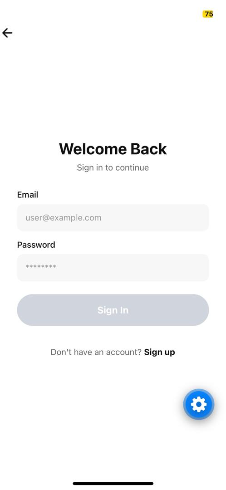 | 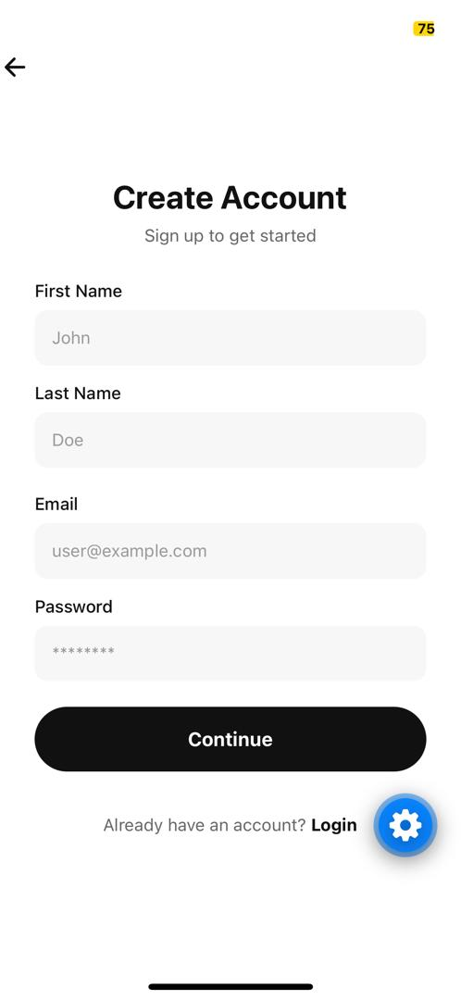 |

### 🛍️ Customer Experience

|                                  Home                                  |                                   All Products                                    |                                     Product Details                                     |
| :--------------------------------------------------------------------: | :-------------------------------------------------------------------------------: | :-------------------------------------------------------------------------------------: |
| 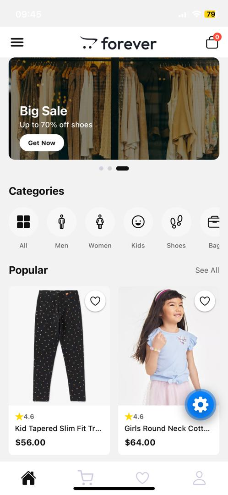 | 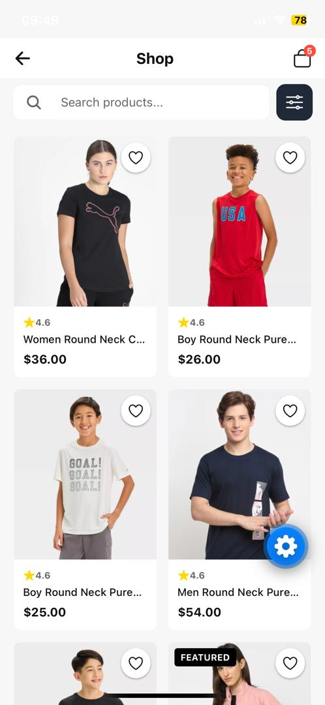 |  |

|                                  Cart                                  |                                    Wishlist                                    |                                    Checkout                                    |
| :--------------------------------------------------------------------: | :----------------------------------------------------------------------------: | :----------------------------------------------------------------------------: |
| 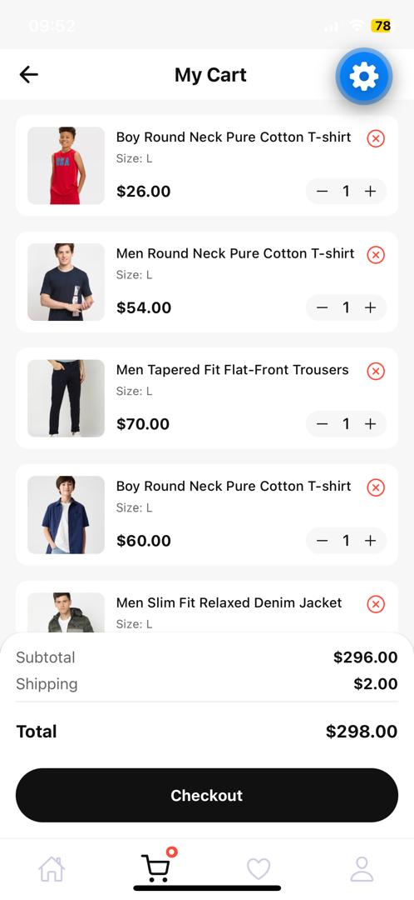 | 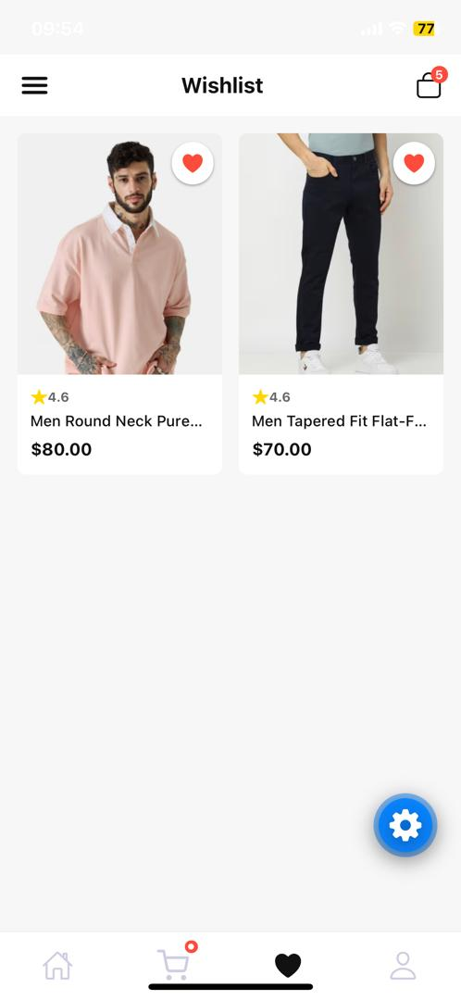 | 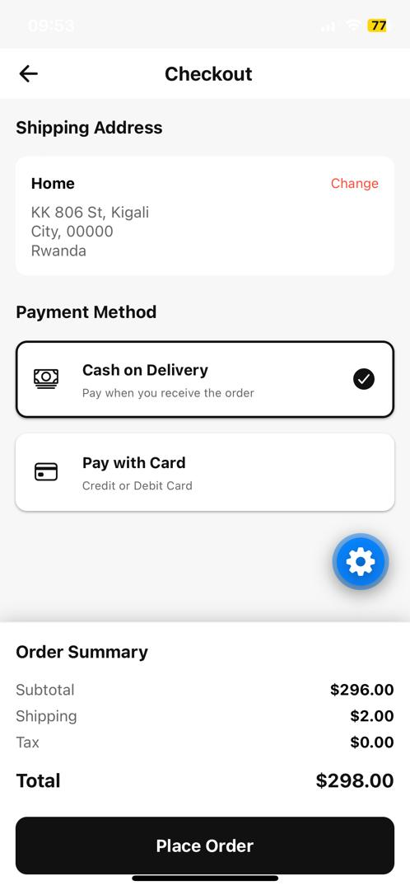 |

|                                         Orders                                         |                                   Profile                                    |     |
| :------------------------------------------------------------------------------------: | :--------------------------------------------------------------------------: | :-: |
| 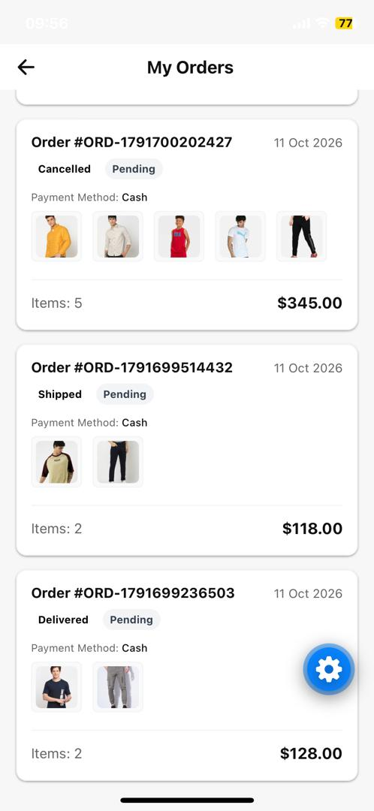 | 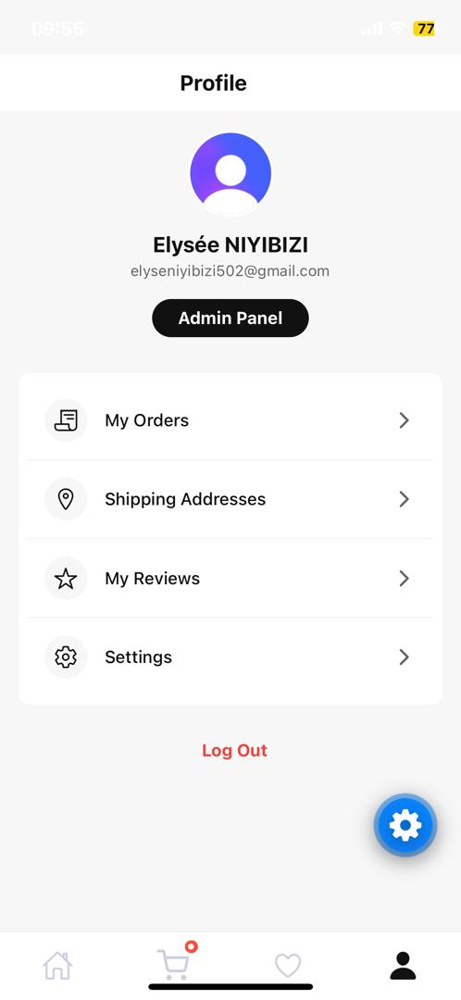 |     |

### 🛠️ Administration

|                                    Admin Dashboard                                     |                                    Products Management                                    |                                   Orders Management                                   |
| :------------------------------------------------------------------------------------: | :---------------------------------------------------------------------------------------: | :-----------------------------------------------------------------------------------: |
| 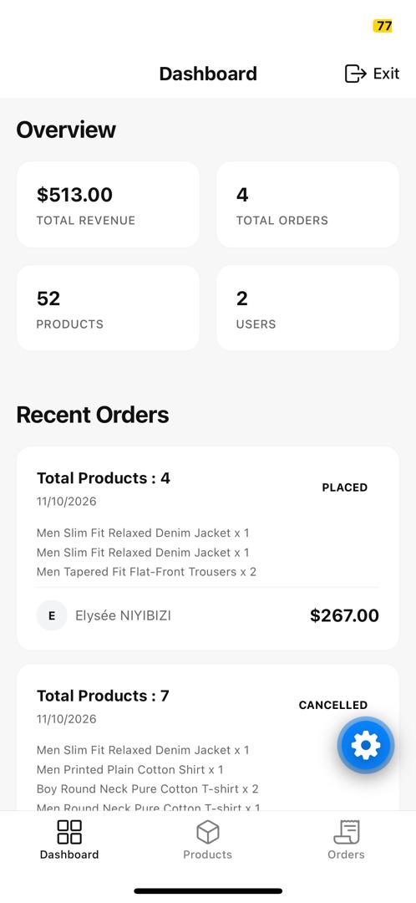 | 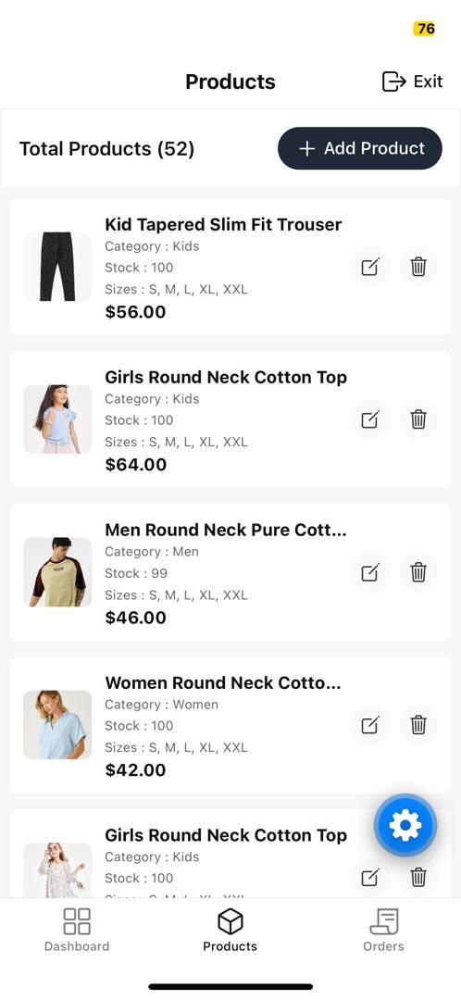 | 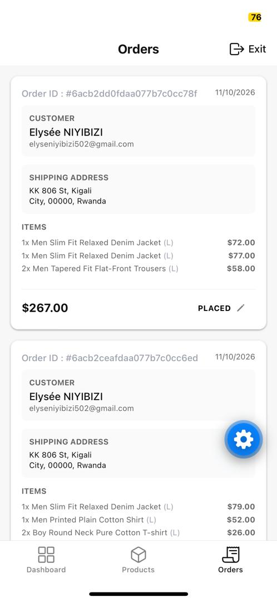 |

|                                         Add New Product                                         |     |     |
| :---------------------------------------------------------------------------------------------: | :-: | :-: |
| 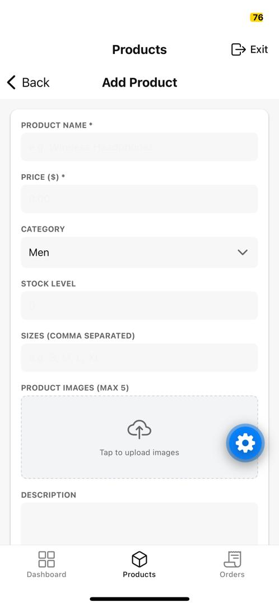 |     |     |

---

## 🛠 Technology Stack

### Client

| Technology                       | Purpose                                         | Badge                                                                                                       |
| -------------------------------- | ----------------------------------------------- | ----------------------------------------------------------------------------------------------------------- |
| **React Native**                 | Native mobile application UI                    |          |
| **Expo**                         | Mobile development tooling and runtime          |                               |
| **Expo Router**                  | File-based navigation and route organization    |         |
| **TypeScript**                   | Static typing for application code              |           |
| **Clerk Expo SDK**               | Client-side sign-in and identity integration    |                          |
| **Axios**                        | HTTP communication with the backend API         |                          |
| **NativeWind**                   | Tailwind-style utility classes for React Native |     |
| **Tailwind CSS**                 | Utility-class configuration                     |      |
| **Expo Image Picker**            | Selecting product images                        |       |
| **Expo Secure Store**            | Secure local storage capability                 |    |
| **React Navigation**             | Navigation primitives used with Expo Router     |     |
| **React Native Toast Message**   | Toast-style user feedback                       |              |
| **React Native Reanimated**      | Animation support                               |           |
| **React Native Gesture Handler** | Gesture handling                                |  |
| **Expo Vector Icons**            | Iconography                                     |            |

### Server

| Technology            | Purpose                                        | Badge                                                                                               |
| --------------------- | ---------------------------------------------- | --------------------------------------------------------------------------------------------------- |
| **Node.js**           | JavaScript runtime                             |           |
| **Express 5**         | HTTP API and routing                           |               |
| **TypeScript**        | Server-side type safety                        |   |
| **MongoDB**           | Document database                              |               |
| **Mongoose**          | MongoDB schemas, models, and queries           |          |
| **Clerk Express SDK** | Server-side identity integration               |               |
| **Cloudinary**        | Product image hosting and upload integration   |  |
| **Multer**            | Multipart file upload middleware               |            |
| **dotenv**            | Environment variable configuration             |             |
| **CORS**              | Cross-origin request configuration             |              |
| **tsx**               | Running TypeScript directly during development |              |
| **Nodemon**           | Restarting the development server on changes   |             |

---

## 🏗 Architecture

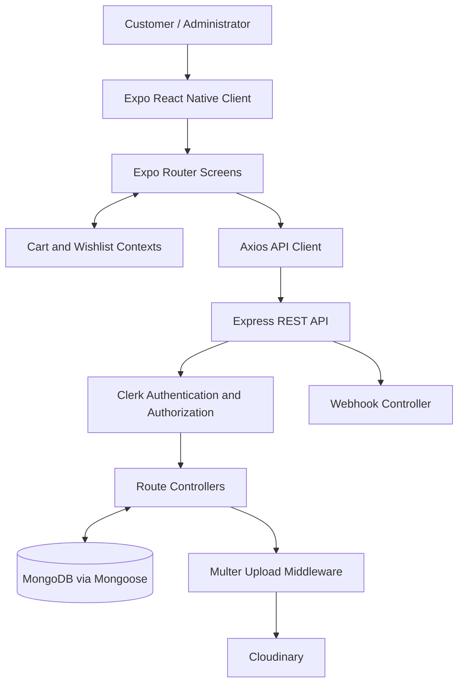

### 🔄 Request Lifecycle

A typical client-to-server operation follows this pattern:

1. A user interacts with a screen in the Expo application.
2. The screen reads or updates relevant UI state and sends an HTTP request through the API client.
3. For protected operations, the client includes a Clerk session token.
4. Express routes direct the request through the configured middleware.
5. Controllers validate or process the request and interact with Mongoose models or external services.
6. The API returns a response to the client, which updates the interface or presents an error.

The precise middleware order, validation rules, and response formats should be confirmed against the implementation of each route and controller.

---

## 📁 Application Structure

```
mobile_ecommerce-app/
├── 📁 client/
│   ├── 📁 app/
│   │   ├── 📁 (auth)/
│   │   │   ├── 📄 sign-in.tsx
│   │   │   ├── 📄 sign-up.tsx
│   │   │   └── 📄 _layout.tsx
│   │   ├── 📁 (tabs)/
│   │   │   ├── 📄 index.tsx
│   │   │   ├── 📄 cart.tsx
│   │   │   ├── 📄 favorites.tsx
│   │   │   ├── 📄 profile.tsx
│   │   │   └── 📄 _layout.tsx
│   │   ├── 📁 addresses/
│   │   │   └── 📄 index.tsx
│   │   ├── 📁 admin/
│   │   │   ├── 📁 products/
│   │   │   │   ├── 📄 add.tsx
│   │   │   │   ├── 📄 index.tsx
│   │   │   │   └── 📁 edit/
│   │   │   │       └── 📄 [id].tsx
│   │   │   ├── 📄 index.tsx
│   │   │   ├── 📄 orders.tsx
│   │   │   └── 📄 _layout.tsx
│   │   ├── 📁 orders/
│   │   │   ├── 📄 index.tsx
│   │   │   └── 📄 [id].tsx
│   │   ├── 📁 product/
│   │   │   └── 📄 [id].tsx
│   │   ├── 📄 checkout.tsx
│   │   ├── 📄 shop.tsx
│   │   └── 📄 _layout.tsx
│   ├── 📁 assets/
│   │   ├── 📁 products-images/
│   │   └── 📁 screenshots/
│   ├── 📁 components/
│   │   ├── 📄 CartItem.tsx
│   │   ├── 📄 CategoryItem.tsx
│   │   ├── 📄 Header.tsx
│   │   └── 📄 ProductCard.tsx
│   ├── 📁 constants/
│   │   ├── 📄 api.ts
│   │   ├── 📄 index.ts
│   │   └── 📄 types.ts
│   ├── 📁 context/
│   │   ├── 📄 CartContext.tsx
│   │   └── 📄 WishlistContext.tsx
│   ├── 📄 package.json
│   └── ...
├── 📁 server/
│   ├── 📁 config/
│   │   ├── 📄 cloudinary.ts
│   │   └── 📄 db.ts
│   ├── 📁 controllers/
│   │   ├── 📄 addressController.ts
│   │   ├── 📄 adminController.ts
│   │   ├── 📄 cartController.ts
│   │   ├── 📄 ordersController.ts
│   │   ├── 📄 productController.ts
│   │   └── 📄 webhooks.ts
│   ├── 📁 middlewares/
│   │   ├── 📄 auth.ts
│   │   └── 📄 upload.ts
│   ├── 📁 models/
│   │   ├── 📄 Address.ts
│   │   ├── 📄 Cart.ts
│   │   ├── 📄 Order.ts
│   │   ├── 📄 Products.ts
│   │   └── 📄 User.ts
│   ├── 📁 routes/
│   │   ├── 📄 addressRoutes.ts
│   │   ├── 📄 adminRoutes.ts
│   │   ├── 📄 cartRoutes.ts
│   │   ├── 📄 ordersRoutes.ts
│   │   └── 📄 productsRoutes.ts
│   ├── 📁 scripts/
│   │   ├── 📄 makeAdmin.ts
│   │   └── 📄 seedProducts.ts
│   ├── 📁 types/
│   ├── 📄 server.ts
│   └── 📄 package.json
└── 📄 README.md
```

### 📂 Folder Responsibilities

| Folder                           | Responsibility                                                                                                                                                                                     |
| -------------------------------- | -------------------------------------------------------------------------------------------------------------------------------------------------------------------------------------------------- |
| **`client/app/`**                | Contains route screens. Route groups organize authentication and tab-based navigation, while dynamic segments such as `product/[id].tsx` and `orders/[id].tsx` represent resource-specific screens |
| **`client/assets/screenshots/`** | Stores UI screenshots used in this README                                                                                                                                                          |
| **`client/components/`**         | Contains reusable interface components used across shopping screens                                                                                                                                |
| **`client/context/`**            | Holds shared cart and wishlist state providers                                                                                                                                                     |
| **`client/constants/`**          | Contains API configuration and shared constants or types                                                                                                                                           |
| **`server/routes/`**             | Maps HTTP endpoints to middleware and controller functions                                                                                                                                         |
| **`server/controllers/`**        | Contains request-handling logic for commerce resources                                                                                                                                             |
| **`server/models/`**             | Defines Mongoose models for application data                                                                                                                                                       |
| **`server/middlewares/`**        | Contains authentication and upload middleware                                                                                                                                                      |
| **`server/config/`**             | Contains database and Cloudinary configuration                                                                                                                                                     |
| **`server/scripts/`**            | Provides scripts for product seeding and administrator setup                                                                                                                                       |

---

## ⚙️ How the Application Works

### 1. 🔐 Authentication

The client includes dedicated sign-in and sign-up screens and uses Clerk's Expo SDK. The server includes Clerk's Express SDK and custom authentication middleware. Protected requests should send a valid session token, and the server should verify the token before processing privileged operations.

### 2. 🔍 Product Discovery

The home and shop screens provide entry points for browsing. Product cards link to product details, where the dynamic route identifies the selected product.

### 3. 🛒 Cart & Wishlist

The client has separate React context providers for cart and wishlist state. This keeps shared state accessible across relevant screens without passing every value through each component manually. Check the implementation to determine which state is local, persisted remotely, or retained only for the current app session.

### 4. 📦 Checkout & Orders

The client includes a checkout screen and screens for listing orders and viewing an individual order. The backend contains cart, address, and order routes, controllers, and models to support these workflows. Payment-provider behavior and order-state transitions should be documented once verified in the corresponding implementation.

### 5. 🛠️ Administrative Product Management

The admin area includes product listing, creation, and editing screens. The add-product interface supports selecting multiple images. The server's product routes use Multer for image files, Clerk-related authentication middleware, and authorization middleware for restricted operations. Cloudinary is configured for image hosting.

### 6. 📍 Addresses & Administration

The application includes saved-address screens and a dedicated admin order screen. Server-side address and admin controllers handle the corresponding API operations.

---

## 🚀 Getting Started

### Prerequisites

| Requirement    | Description                                                            |
| -------------- | ---------------------------------------------------------------------- |
| **Node.js**    | Version compatible with the installed Expo SDK and server dependencies |
| **npm**        | Package manager                                                        |
| **MongoDB**    | Connection string, using MongoDB Atlas or a local MongoDB instance     |
| **Clerk**      | Application credentials                                                |
| **Cloudinary** | Credentials for product image uploads                                  |
| **Expo Go**    | Or an appropriate simulator/emulator for running the client            |

Use the Expo documentation to confirm the Node.js and platform requirements for your installed Expo SDK version.

### 1. Clone the Repository

```bash
git clone https://github.com/elyse502/mobile_ecommerce-app.git
cd mobile_ecommerce-app
```

### 2. Install Client Dependencies

```bash
cd client
npm install
```

### 3. Install Server Dependencies

Open another terminal from the repository root:

```bash
cd server
npm install
```

> **Note:** Keep the client and server dependency installations separate. Each directory has its own `package.json`.

---

## 🔧 Environment Configuration

Create environment files locally. Never commit real secrets or production credentials.

### Client: `client/.env`

```env
EXPO_PUBLIC_CLERK_PUBLISHABLE_KEY=<your-clerk-publishable-key>
```

Set the publishable key from your Clerk application.

> **⚠️ Important:** Variables prefixed with `EXPO_PUBLIC_` are embedded into the client bundle and are not secret. Never place a Clerk secret key, Cloudinary API secret, database URI, or other private credential in the client environment.

### Server: `server/.env`

```env
# Administrator configuration
ADMIN_EMAIL=<your-admin-email>

# Database
MONGODB_URI=<your-mongodb-connection-string>

# Clerk server credentials
CLERK_PUBLISHABLE_KEY=<your-clerk-publishable-key>
CLERK_SECRET_KEY=<your-clerk-secret-key>
CLERK_WEBHOOK_SIGNING_SECRET=<your-clerk-webhook-signing-secret>

# Cloudinary media storage
CLOUDINARY_CLOUD_NAME=<your-cloudinary-cloud-name>
CLOUDINARY_API_KEY=<your-cloudinary-api-key>
CLOUDINARY_API_SECRET=<your-cloudinary-api-secret>
```

Fill each value from the relevant provider dashboard or local database configuration.

| Variable                       | Purpose                                                                                        |
| ------------------------------ | ---------------------------------------------------------------------------------------------- |
| `ADMIN_EMAIL`                  | Email used by the application's administrator setup logic, if referenced by the implementation |
| `MONGODB_URI`                  | Connection URI for the MongoDB database                                                        |
| `CLERK_PUBLISHABLE_KEY`        | Public Clerk application key used by the server integration                                    |
| `CLERK_SECRET_KEY`             | Private server-side Clerk key                                                                  |
| `CLERK_WEBHOOK_SIGNING_SECRET` | Secret used to verify supported Clerk webhook events                                           |
| `CLOUDINARY_CLOUD_NAME`        | Cloudinary product environment name                                                            |
| `CLOUDINARY_API_KEY`           | Cloudinary API key                                                                             |
| `CLOUDINARY_API_SECRET`        | Private Cloudinary API secret                                                                  |

The exact environment variable names must match the names referenced in the source code. If your implementation uses different names, update the example and local environment files to match.

### Verify `.gitignore`

Ensure both `client/.env` and `server/.env` are excluded from Git. Commit the example files, not the real environment files.

---

## 🏃 Running the Application

### Start the Backend

In a terminal:

```bash
cd server
npm run server
```

This runs `nodemon --exec tsx server.ts`, which restarts the server when watched files change.

To run the server using the start script:

```bash
npm start
```

The supplied development logs show the API running at `http://localhost:3000`. Confirm the port in `server.ts` before relying on this value.

### Start the Mobile Client

In a separate terminal:

```bash
cd client
npm start
```

Expo will display development options and a QR code.

Platform-specific scripts are also available:

```bash
npm run android
npm run ios
npm run web
```

> **Note:** The iOS simulator workflow requires macOS and the relevant Apple development tools. Other platform requirements depend on your environment.

### Configure the API Base URL

Inspect `client/constants/api.ts` and configure the API URL for your development environment.

The address `http://localhost:3000` works for requests originating on the same computer. When testing on a physical phone, `localhost` refers to the phone itself, not your development computer. Use your computer's reachable LAN IP address or a deployed HTTPS API endpoint.

For example:

```text
http://192.168.1.10:3000
```

Replace the example address with your computer's actual local network address. Ensure the phone and computer can communicate over the network and that your firewall permits the connection.

For a production build, configure a stable HTTPS backend URL.

### Optional Server Checks

Run the TypeScript build:

```bash
cd server
npm run build
```

Run the client lint script:

```bash
cd client
npm run lint
```

Resolve reported errors before merging or deploying changes.

---

## 📡 API Overview

The server is organized into resource-oriented route modules. The exact base paths, HTTP methods, payload schemas, and response formats should be taken from `server.ts` and the corresponding route files.

| Area               | Route Module        | Responsibility                                          |
| ------------------ | ------------------- | ------------------------------------------------------- |
| **Products**       | `productsRoutes.ts` | Product retrieval and administrative product operations |
| **Cart**           | `cartRoutes.ts`     | Cart-related operations                                 |
| **Addresses**      | `addressRoutes.ts`  | Saved-address operations                                |
| **Orders**         | `ordersRoutes.ts`   | Order-related operations                                |
| **Administration** | `adminRoutes.ts`    | Administrative operations                               |

### Product Route Example

The supplied implementation includes product routes with this structure:

| Method   | Route  | Purpose                                            |
| -------- | ------ | -------------------------------------------------- |
| `GET`    | `/`    | Retrieve products                                  |
| `GET`    | `/:id` | Retrieve one product                               |
| `POST`   | `/`    | Create a product, including uploaded images        |
| `PUT`    | `/:id` | Update a product, including optional image changes |
| `DELETE` | `/:id` | Delete a product                                   |

These paths are relative to the product router's mount path in `server.ts`. For example, if the router is mounted at `/api/products`, the create endpoint is `POST /api/products`.

Product creation, update, and deletion are protected by authentication and administrator authorization in the supplied route configuration. Requests to create products use multipart form data when images are attached.

This is a route-level overview, not a complete API contract. Consult the source code for required fields, validation rules, query parameters, status codes, and response bodies.

---

## 🔐 Authentication & Authorization

The project integrates Clerk on both sides of the application:

- The client uses `@clerk/clerk-expo`
- The server uses `@clerk/express`
- The server includes custom authentication middleware in `middlewares/auth.ts`
- Product routes apply authentication and authorization middleware to restricted operations
- A `makeAdmin.ts` script is provided for administrator setup

### Authentication vs Authorization

| Concept            | Definition                                                                   |
| ------------------ | ---------------------------------------------------------------------------- |
| **Authentication** | Verifies the user's identity                                                 |
| **Authorization**  | Checks whether the authenticated user has permission to perform an operation |

> **⚠️ Important:** Administrative access must be enforced on the server. Hiding an admin screen in the client alone is not sufficient to protect an API endpoint.

Review the `makeAdmin.ts` script before running it. Ensure it targets the intended user and database environment.

---

## 🗄️ Data Model Overview

The server contains Mongoose models for the following entities:

| Model         | Responsibility       |
| ------------- | -------------------- |
| `User.ts`     | User-related data    |
| `Products.ts` | Product catalog data |
| `Cart.ts`     | Shopping cart data   |
| `Order.ts`    | Order data           |
| `Address.ts`  | Saved address data   |

The actual fields, indexes, references, validation rules, and relationships are defined in the model files. Review those definitions before extending the schema or building integrations.

---

## 🧠 Engineering Decisions

### Separate Client & Server Applications

The repository keeps the mobile interface and API in separate directories. Each application has its own dependencies, scripts, and TypeScript configuration. This separation makes responsibilities easier to understand and lets the client and server evolve independently.

### File-Based Navigation

Expo Router maps files under `client/app/` to application routes. Route groups organize authentication and tab screens, while dynamic segments support resource-specific pages such as product and order details.

### Reusable Components & Shared State

Common interface elements live under `client/components/`, while cart and wishlist contexts live under `client/context/`. This structure reduces duplication and gives shared shopping state a dedicated home.

### Controller & Route Separation

The server separates route declarations, controllers, models, middleware, and configuration. Routes describe how requests are dispatched, controllers handle request processing, models represent persistent data, and middleware handles cross-cutting concerns.

### External Service Integrations

Clerk handles identity integration, MongoDB stores application data, and Cloudinary handles image hosting. Each service requires correct environment configuration and should be tested independently during setup.

---

## 🐛 Troubleshooting

### The Mobile App Cannot Reach the API

- Check that the backend is running
- Check the API base URL in `client/constants/api.ts`
- Replace `localhost` with your development computer's LAN IP when testing on a physical phone
- Confirm that the phone and computer share a reachable network
- Check firewall rules and server port configuration

### Clerk Authentication Fails

- Verify `EXPO_PUBLIC_CLERK_PUBLISHABLE_KEY` in `client/.env`
- Verify the server's Clerk keys in `server/.env`
- Confirm the values belong to the same Clerk application and environment
- Restart the relevant development process after changing environment variables
- Confirm that protected requests include a valid session token

### MongoDB Connection Fails

- Verify `MONGODB_URI`
- Confirm the database service is running or the Atlas cluster is available
- For Atlas, check network access rules and database-user permissions
- Review the server logs for the connection error

### Product Image Upload Fails

- Verify the Cloudinary cloud name, API key, and API secret in the server environment
- Confirm the credentials belong to the same Cloudinary product environment
- Check the Multer configuration and ensure the route accepts the expected multipart field name
- Inspect the detailed server-side Cloudinary error. A generic HTTP 500 from the API might wrap a more specific upstream error
- Keep Cloudinary private credentials on the server. Never place the API secret in the Expo client

### TypeScript Build Fails

- Run `npm install` in the relevant application directory
- Check the error path and TypeScript diagnostics
- Verify the installed Node.js version against the requirements of the dependencies
- Fix the underlying type or configuration issue rather than suppressing the error without investigation

---

## 🔒 Security Considerations

This project integrates authentication, a database, image uploads, and administrative endpoints. Before production use:

| Consideration          | Action                                                                                          |
| ---------------------- | ----------------------------------------------------------------------------------------------- |
| **Secrets Management** | Keep `.env` files and secrets out of version control                                            |
| **Input Validation**   | Validate and sanitize all client-supplied fields on the server                                  |
| **Authorization**      | Enforce authorization on every privileged endpoint                                              |
| **File Uploads**       | Restrict image file types, file sizes, and upload counts                                        |
| **Webhooks**           | Verify webhook signatures before processing external events                                     |
| **HTTPS**              | Use HTTPS for deployed APIs                                                                     |
| **CORS**               | Apply appropriate CORS rules and request limits                                                 |
| **Error Handling**     | Avoid returning internal stack traces or sensitive provider errors to clients                   |
| **Database**           | Review database permissions, indexes, backups, and connection settings                          |
| **Payments**           | Verify order and checkout logic, including payment handling, before accepting real transactions |
| **Testing**            | Add automated tests for authentication, authorization, product operations, and order workflows  |

---

## 🔮 Potential Improvements

The following are possible next steps, not claims about existing functionality:

| Improvement                                                                                                               | Priority |
| ------------------------------------------------------------------------------------------------------------------------- | -------- |
| Add automated unit and integration tests for the client and API                                                           | High     |
| Publish an API specification with request and response examples                                                           | High     |
| Add structured logging and consistent error-response formats                                                              | Medium   |
| Add pagination, filtering, sorting, and search where needed for larger catalogs                                           | Medium   |
| Add CI checks for linting, TypeScript compilation, and tests                                                              | Medium   |
| Document deployment steps and maintain separate development and production environment configurations                     | Medium   |
| Add accessibility checks and test on multiple screen sizes and Android/iOS devices                                        | Low      |
| Add a clear payment-provider integration and verified order lifecycle if online payments are part of the intended product | Low      |

---

## 👨‍💻 Author

### **Elysée NIYIBIZI**

_Computer Science Graduate | Fullstack Software Engineer_

<div align="center">

[](https://elyseedev.netlify.app)
[](https://github.com/elyse502)
[](https://linkedin.com/in/niyibizi-elys%C3%A9e)
[](mailto:elyseniyibizi502@gmail.com)
[](https://x.com/Niyibizi_Elyse)

</div>

**Specialties:**

- 📱 Mobile Application Development
- 🔧 Backend Development
- 📘 TypeScript Applications
- 🗄️ Database Architecture
- 🛒 E-Commerce Solutions

If this project interests you, explore the source code, open an issue with reproducible details, or connect through GitHub.

---

## 📄 License

This project is licensed under the **MIT License** - see the [LICENSE](https://github.com/elyse502/mobile_ecommerce-app/blob/main/LICENSE) file for details.

```
MIT License

Copyright (c) 2026 Elysée NIYIBIZI

Permission is hereby granted, free of charge, to any person obtaining a copy
of this software and associated documentation files (the "Software"), to deal
in the Software without restriction...
```

---

<div align="center">

### ⭐ Star this repository if you find it helpful for learning mobile e-commerce development!

**Built with 📱, React Native, Expo, TypeScript, Express, MongoDB, Clerk, and Cloudinary**

---

_From product discovery to checkout — a complete mobile shopping experience_

[⬆ Back to Top](#-table-of-contents)

</div>
